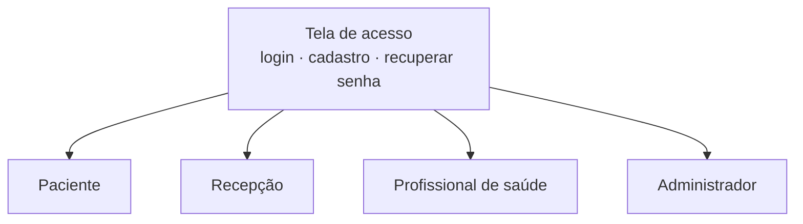
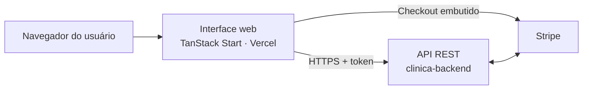
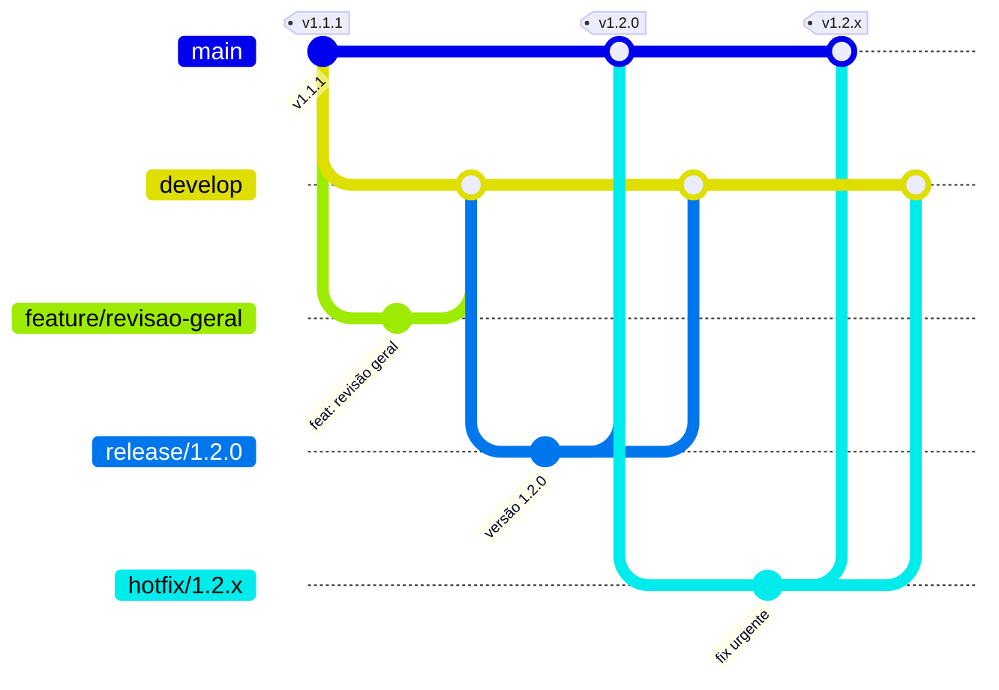

<div align="center">

# Gestão de Consultas: Interface Web Acessível para Agendamento de Consultas Médicas

**Projeto Integrador · SENAI**


[Acessar o site](https://gestao-consultas.vercel.app) · [API](https://github.com/clinica-consulta/clinica-backend) · [Versões](https://github.com/clinica-consulta/clinica-frontend/releases) · [Quadro do projeto](https://github.com/orgs/clinica-consulta/projects/3)

</div>

---

## Sumário

1. [Identificação](#1-identificação)
2. [Resumo](#2-resumo)
3. [Introdução](#3-introdução)
4. [Objetivos](#4-objetivos)
5. [Metodologia](#5-metodologia)
6. [Público-alvo e perfis de acesso](#6-público-alvo-e-perfis-de-acesso)
7. [Requisitos da interface](#7-requisitos-da-interface)
8. [Funcionalidades por perfil](#8-funcionalidades-por-perfil)
9. [Experiência do usuário e acessibilidade](#9-experiência-do-usuário-e-acessibilidade)
10. [Pagamento da consulta](#10-pagamento-da-consulta)
11. [Arquitetura e tecnologias](#11-arquitetura-e-tecnologias)
12. [Qualidade e implantação](#12-qualidade-e-implantação)
13. [Resultados e versões](#13-resultados-e-versões)
14. [Considerações finais e trabalhos futuros](#14-considerações-finais-e-trabalhos-futuros)
15. [Referências](#15-referências)
- [Apêndice A: gestão do projeto](#apêndice-a-gestão-do-projeto)
- [Apêndice B: fluxo de trabalho (Git Flow)](#apêndice-b-fluxo-de-trabalho-git-flow)

---

## 1. Identificação

| Item | Descrição |
|---|---|
| **Título** | Gestão de Consultas: interface web acessível para agendamento de consultas médicas |
| **Natureza** | Projeto Integrador |
| **Instituição** | SENAI |
| **Repositório** | `clinica-consulta/clinica-frontend` (interface web) |
| **Repositório complementar** | [`clinica-consulta/clinica-backend`](https://github.com/clinica-consulta/clinica-backend) (API REST) |

**Equipe**

| Integrante | GitHub |
|---|---|
| Marco Antônio | [@mocotoTonin](https://github.com/mocotoTonin) |
| João Alexandre | [@joaoalex4ndr3](https://github.com/joaoalex4ndr3) |
| Rafaela Silva da Paz | [@Blightpb](https://github.com/Blightpb) |
| Luis Felipe Correia | [@LuisFelipeCorreia](https://github.com/LuisFelipeCorreia) |
| Tuanny Thomazelli | [@TuannyThomazelli](https://github.com/TuannyThomazelli) |

---

## 2. Resumo

Este trabalho apresenta o desenvolvimento da interface web da plataforma **Gestão de Consultas**, voltada a clínicas médicas. A proposta é permitir que qualquer pessoa, inclusive idosos e pessoas com pouca familiaridade com tecnologia, consiga agendar uma consulta em poucos passos, visualizando na hora os horários disponíveis, e que a equipe da clínica concentre em um só lugar a agenda, os pacientes, a comunicação e os indicadores. A interface foi construída com React e TypeScript sobre o framework TanStack Start, com estilização em Tailwind CSS e componentes acessíveis do Radix UI, e consome a API REST do projeto. O sistema oferece uma área específica para cada perfil (paciente, recepção, profissional de saúde e administrador), adapta-se a celulares e computadores e aplica, na própria tela, as regras de negócio da clínica, como a cobertura do convênio e a disponibilidade de horários. O pagamento da consulta particular é feito dentro do próprio site, por meio do Checkout embutido do Stripe, com Pix, cartão e boleto.

**Palavras-chave:** interface web; acessibilidade; agendamento de consultas; React; experiência do usuário; pagamentos on-line.

---

## 3. Introdução

### 3.1 Contextualização

O agendamento de consultas por telefone ou presencialmente depende do horário de funcionamento da recepção e não permite ao paciente enxergar as opções disponíveis. Do lado da clínica, a informação costuma ficar espalhada entre agendas, planilhas e aplicativos de mensagem.

### 3.2 Problema

Sistemas de agendamento existentes muitas vezes apresentam telas carregadas, letras pequenas e fluxos longos, o que dificulta o uso por pessoas idosas, justamente um público frequente em clínicas. Além disso, a ausência de confirmação e de lembretes contribui para as faltas.

### 3.3 Justificativa

Uma interface clara, responsiva e orientada por etapas reduz a barreira de uso, diminui a dependência da recepção e permite que o paciente confirme, remarque, cancele e pague a consulta por conta própria. Para a equipe, reunir agenda, pacientes, fila de espera e indicadores na mesma ferramenta reduz o retrabalho.

### 3.4 Escopo deste repositório

Este repositório contém a **interface web**. Os dados e as regras de negócio são fornecidos pela [API da Gestão de Consultas](https://github.com/clinica-consulta/clinica-backend).

---

## 4. Objetivos

### 4.1 Objetivo geral

Desenvolver uma interface web acessível e responsiva que permita ao paciente agendar e acompanhar suas consultas e à equipe da clínica gerenciar a agenda e o atendimento de forma centralizada.

### 4.2 Objetivos específicos

- Oferecer um fluxo guiado de agendamento: especialidade, médico, data e horário.
- Criar áreas distintas para cada perfil, exibindo apenas as ações pertinentes a ele.
- Garantir legibilidade e uso confortável no celular e no computador.
- Apresentar as regras da clínica de forma clara, explicando quando uma ação não é permitida.
- Disponibilizar confirmação de presença, lembretes e notificações para reduzir faltas.
- Permitir o pagamento da consulta particular dentro do site.
- Integrar a interface à API REST com sessão autenticada.

---

## 5. Metodologia

O desenvolvimento seguiu uma abordagem **iterativa e incremental**, com protótipos de tela, entregas versionadas e acompanhamento das tarefas em quadro Kanban.

| Prática | Aplicação no projeto |
|---|---|
| **Prototipação** | Esboços e wireframes das telas principais antes da implementação |
| **Planejamento por issues** | Cada tela ou funcionalidade é uma issue com código padronizado (ex.: `[PCT-02-FE]`), agrupada em épicos. Ver [Apêndice A](#apêndice-a-gestão-do-projeto). |
| **Quadro Kanban** | Acompanhamento no [GitHub Projects](https://github.com/orgs/clinica-consulta/projects/3) |
| **Controle de versão** | Git com o modelo **Git Flow** e revisão por pull request. Ver [Apêndice B](#apêndice-b-fluxo-de-trabalho-git-flow). |
| **Versionamento semântico** | Entregas identificadas por `MAIOR.MENOR.CORREÇÃO` e publicadas como releases |
| **Padrão de commits** | Mensagens no formato `tipo: descrição` (`feat`, `fix`, `docs`, `test`, `chore`) |

---

## 6. Público-alvo e perfis de acesso

O site possui uma tela de acesso única. Após o login, cada pessoa é direcionada para a área do seu perfil.



| Perfil | Público | Necessidade principal |
|---|---|---|
| **Paciente** | Pessoas de todas as idades atendidas pela clínica | Agendar e acompanhar consultas com facilidade |
| **Recepção** | Equipe de atendimento | Visão completa da agenda e agilidade no atendimento |
| **Profissional de saúde** | Médicos do corpo clínico | Consultar a agenda do dia e registrar o atendimento |
| **Administrador** | Gestão da clínica | Configurar a clínica e acompanhar indicadores |

---

## 7. Requisitos da interface

### 7.1 Requisitos funcionais

| Código | Requisito |
|---|---|
| RF01 | Permitir login, cadastro de paciente e recuperação de senha por código enviado ao e-mail. |
| RF02 | Direcionar cada usuário para a área do seu perfil após o login. |
| RF03 | Conduzir o agendamento em etapas: especialidade, médico, data e horário livre. |
| RF04 | Exibir apenas horários disponíveis e, no dia corrente, apenas horários futuros. |
| RF05 | Informar quando o convênio do paciente não cobre a especialidade escolhida. |
| RF06 | Permitir ao paciente confirmar, remarcar e cancelar consultas. |
| RF07 | Exibir o histórico de consultas e o histórico de alterações de cada consulta. |
| RF08 | Disponibilizar à recepção a agenda de todos os médicos, com filtros. |
| RF09 | Permitir à recepção cadastrar pacientes, gerenciar a fila de espera, enviar lembretes e registrar bloqueios. |
| RF10 | Permitir ao profissional registrar atendimento ou ausência e emitir atestados e receitas. |
| RF11 | Permitir ao administrador gerenciar usuários, médicos, especialidades, convênios, expedientes e configurações. |
| RF12 | Exibir indicadores e permitir a exportação de planilhas e relatórios. |
| RF13 | Exibir notificações com contador de não lidas. |
| RF14 | Permitir o pagamento da consulta particular dentro do site, por Pix, cartão ou boleto. |
| RF15 | Oferecer busca global por pacientes, médicos, usuários e especialidades. |

### 7.2 Requisitos não funcionais

| Código | Requisito |
|---|---|
| RNF01 | **Usabilidade:** fluxos curtos, linguagem simples e mensagens que explicam o motivo de cada bloqueio. |
| RNF02 | **Acessibilidade:** componentes com semântica e atributos ARIA, navegação por teclado e bom contraste, tendo como referência as WCAG 2.1. |
| RNF03 | **Responsividade:** menu lateral no computador e barra inferior no celular. |
| RNF04 | **Segurança:** sessão por token; dados de pagamento digitados apenas em componente do Stripe. |
| RNF05 | **Desempenho:** carregamento por rota e atualização dos dados sem recarregar a página. |
| RNF06 | **Manutenibilidade:** código em TypeScript, com rotas por arquivo e componentes reutilizáveis. |

### 7.3 Regras de negócio refletidas na interface

| Situação | Comportamento da interface |
|---|---|
| Convênio não cobre a especialidade | O agendamento é bloqueado e o motivo é explicado |
| Horário ocupado ou bloqueado | O horário não aparece como opção |
| Agendamento para hoje | Só aparecem horários a partir da hora atual |
| Consulta cancelada | O horário volta a ficar livre na agenda |
| Consulta remarcada | O paciente precisa confirmar a nova data |
| Paciente, médico ou especialidade desativados | Deixam de aparecer no agendamento, mas o histórico continua visível |
| Médico com consultas | Não pode ser excluído, apenas desativado |
| Consulta particular realizada | O botão de pagamento aparece na consulta e nas notificações |
| Consulta marcada | Fica aguardando confirmação; o botão de confirmar só aparece para o paciente depois que a recepção envia o pedido de confirmação |
| Consultas e agenda do médico | Abrem no dia de hoje e viram o dia sozinhas à meia-noite; setas para os outros dias e opção "Todas as datas" |
| Antes do horário da consulta | A recepção pode pedir a confirmação, remarcar ou cancelar (com confirmação) |
| Resultado da consulta | A recepção marca "Realizada" ou "Não aconteceu" a qualquer momento e pode corrigir depois; consulta paga não deixa de ser realizada |
| Do horário até 1 hora depois | A consulta aparece em "Em atendimento"; o médico só registra o resultado nesse período |
| Passou 1 hora sem registro | A API encerra a consulta sozinha e a tela se atualiza; a recepção ainda pode corrigir o resultado |
| Paciente com convênio | O cadastro pede número, plano e validade da carteirinha; com a carteirinha vencida, o agendamento é bloqueado |
| Particular com pagamento pendente | A recepção pode lembrar o pagamento, no máximo uma vez a cada 24 horas |
| Paciente não compareceu | O paciente recebe o aviso "Sentimos sua falta" com o botão "Agendar novo horário" |

---

## 8. Funcionalidades por perfil

### 8.1 Paciente

| Tela | Funcionalidades |
|---|---|
| **Início** | Próximas consultas com status e código, confirmação de presença, remarcação, cancelamento com confirmação e histórico das consultas |
| **Agendar** | Fluxo guiado por especialidade, médico, data e horário, com aviso de cobertura do convênio |
| **Notificações** | Avisos da clínica, lembretes, atestados e receitas para abrir e imprimir, e pagamento da consulta particular |
| **Meu perfil** | Dados cadastrais, contato e convênio |

### 8.2 Recepção

| Tela | Funcionalidades |
|---|---|
| **Dashboard** | Indicadores e atendimentos do dia; um horário vago abre o agendamento já preenchido |
| **Agenda** | Agenda de todos os médicos, com filtros e horários livres, ocupados e bloqueados |
| **Consultas** | Filtros por data, médico, especialidade e status; agendar, confirmar, remarcar, cancelar, enviar lembretes e registrar realizada ou não compareceu |
| **Pacientes** | Cadastro com máscaras de CPF e telefone, edição, desativação e histórico |
| **Fila de espera** | Pacientes aguardando vaga, com prioridade, convite e agendamento direto |
| **Médicos** | Corpo clínico com filtro por especialidade |
| **Horários e bloqueios** | Expedientes dos médicos e bloqueio de horários ou períodos |
| **Notificações** | Avisos da equipe e envio de avisos a pacientes e médicos |

### 8.3 Profissional de saúde

| Tela | Funcionalidades |
|---|---|
| **Início** | Consultas do dia e registro de atendimento realizado ou ausência |
| **Minha agenda** | Consultas por data |
| **Meus pacientes** | Prontuário com histórico de consultas e emissão de atestado, receita ou pedido de exame, com envio ao paciente e impressão |
| **Meus horários** | Expediente e bloqueios em modo somente leitura |
| **Notificações** | Avisos da clínica |

### 8.4 Administrador

| Tela | Funcionalidades |
|---|---|
| **Visão geral** | Indicadores da clínica, relatório completo e planilhas de consultas e de alterações prontas para o Excel |
| **Usuários** | Acessos da recepção e de outros administradores |
| **Médicos** | Cadastro, edição, ativação, desativação e exclusão de médicos sem consultas |
| **Especialidades** | Catálogo de especialidades |
| **Agendas e horários** | Expediente semanal de cada médico e bloqueios |
| **Configurações** | Dados da clínica, convênios com as especialidades cobertas e valor da consulta particular |

### 8.5 Recursos comuns

- **Busca no topo:** encontra pacientes, médicos, usuários e especialidades e abre a tela correspondente já filtrada; para o paciente, leva ao agendamento da especialidade.
- **Minha conta:** edição de nome e telefone e troca de senha.
- **Recuperação de senha:** código de 6 dígitos enviado por e-mail, com confirmação de CPF.
- **Notificações:** contador de não lidas e opção de marcar todas como lidas.
- **Rodapé:** Privacidade, Termos de Uso e Suporte com o contato da clínica.

---

## 9. Experiência do usuário e acessibilidade

A interface foi projetada considerando usuários de todas as idades:

| Diretriz | Aplicação |
|---|---|
| Clareza | Uma ação principal por tela e linguagem direta, sem jargões técnicos |
| Prevenção de erros | Opções indisponíveis não são exibidas e ações destrutivas pedem confirmação |
| Feedback | Mensagens de sucesso, erro e carregamento em cada ação |
| Legibilidade | Tipografia legível, botões grandes e bom contraste |
| Acessibilidade | Componentes Radix UI com suporte a teclado e leitores de tela; atributos ARIA em controles personalizados |
| Responsividade | Layout adaptado a celular, tablet e computador |
| Consistência | Mesmos padrões visuais e de navegação em todas as áreas |

---

## 10. Pagamento da consulta

Quando a consulta de um paciente do convênio **Particular** é registrada como realizada, o paciente recebe uma notificação de pagamento disponível. O pagamento é feito **dentro do próprio site**: o modal de pagamento exibe o **Checkout embutido do Stripe**, com as formas de pagamento ativas na conta da clínica.

| Forma de pagamento | Experiência no site |
|---|---|
| **Pix** | QR Code e código "copia e cola" exibidos dentro da página |
| **Cartão de crédito e débito** | Dados digitados no formulário do Stripe; a autenticação do banco (3D Secure), quando exigida, abre dentro da página |
| **Boleto** | Boleto gerado e exibido na página |
| **Carteiras digitais** | Apple Pay, Google Pay e Link, quando disponíveis no dispositivo |

Ao concluir, a interface consulta a API e exibe o comprovante. Pagamentos por Pix ou boleto ainda não compensados aparecem como "aguardando confirmação", e o paciente é avisado por notificação quando o pagamento é confirmado. Os dados de pagamento vão diretamente para o Stripe e nunca passam pela API da clínica. Quando o Stripe não está configurado na API, a interface utiliza um modo de pagamento simulado para demonstração.

---

## 11. Arquitetura e tecnologias

### 11.1 Visão geral



### 11.2 Tecnologias

| Camada | Tecnologia | Justificativa |
|---|---|---|
| Linguagem | TypeScript | Tipagem estática e menos erros em tempo de execução |
| Biblioteca de interface | React 19 | Componentização e grande ecossistema |
| Framework | TanStack Start e TanStack Router | Rotas por arquivo, tipadas, com carregamento por rota |
| Estilização | Tailwind CSS 4 | Consistência visual e produtividade |
| Componentes | Radix UI | Componentes acessíveis e sem estilo pré-definido |
| Ícones | Lucide | Conjunto de ícones consistente |
| Pagamentos | Stripe.js (Checkout embutido) | Pagamento dentro do site com conformidade PCI garantida pelo Stripe |
| Hospedagem | Vercel | Publicação contínua a partir do repositório |

### 11.3 Organização do código

```
src/
├── routes/        Uma rota por tela, separadas por perfil
├── components/    Páginas de cada perfil, formulários, modais e componentes de interface
├── lib/           Cliente da API, estado compartilhado, CPF e exportação de planilhas
├── hooks/         Hooks reutilizáveis
└── assets/        Logo e imagens
docs/              Guia técnico de desenvolvimento e publicação
```

A comunicação com a API está concentrada em `src/lib/api.ts`, que converte os dados entre o formato da API e o da interface, e o estado compartilhado fica em `src/lib/clinic-store.tsx`.

---

## 12. Qualidade e implantação

| Item | Ferramenta |
|---|---|
| Verificação de tipos | TypeScript (`tsc --noEmit`) |
| Padronização de código | ESLint e Prettier |
| Build de produção | Vite (`npm run build`) |
| Publicação | [Vercel](https://gestao-consultas.vercel.app) |

As instruções para executar o site localmente e publicá-lo estão no guia técnico [docs/desenvolvimento.md](docs/desenvolvimento.md).

---

## 13. Resultados e versões

O projeto resultou em uma interface publicada, integrada à API e utilizada pelos quatro perfis de acesso. As entregas foram organizadas em versões:

| Versão | Entregas |
|---|---|
| [1.9.0](https://github.com/clinica-consulta/clinica-frontend/releases/tag/v1.9.0) | Animação sutil ao rolar com GSAP |
| [1.8.0](https://github.com/clinica-consulta/clinica-frontend/releases/tag/v1.8.0) | Botão Excluir paciente no cadastro |
| [1.7.1](https://github.com/clinica-consulta/clinica-frontend/releases/tag/v1.7.1) | Horário já marcado some da agenda para todos, inclusive na tela do paciente |
| [1.7.0](https://github.com/clinica-consulta/clinica-frontend/releases/tag/v1.7.0) | Consultas por dia, botão Realizada à vista, confirmação após o pedido e data digitável |
| [1.6.0](https://github.com/clinica-consulta/clinica-frontend/releases/tag/v1.6.0) | Pedido de confirmação ao paciente, resultado a qualquer momento e carteirinha do convênio no cadastro |
| [1.5.0](https://github.com/clinica-consulta/clinica-frontend/releases/tag/v1.5.0) | Telas seguem o ciclo da consulta, com lembrete de pagamento e convite para remarcar após ausência |
| [1.4.0](https://github.com/clinica-consulta/clinica-frontend/releases/tag/v1.4.0) | Recepção: lembrete, confirmação e registro de consulta realizada aparecem uma única vez |
| [1.3.0](https://github.com/clinica-consulta/clinica-frontend/releases/tag/v1.3.0) | Pagamento da consulta particular pelo Stripe dentro do site (Pix, cartão e boleto) e documentação no formato acadêmico |
| [1.2.2](https://github.com/clinica-consulta/clinica-frontend/releases/tag/v1.2.2) | Documentação profissional e padronização de issues, labels e cards |
| [1.2.1](https://github.com/clinica-consulta/clinica-frontend/releases/tag/v1.2.1) | Documentação do projeto e padronização do Git Flow |
| [1.2.0](https://github.com/clinica-consulta/clinica-frontend/releases/tag/v1.2.0) | Revisão geral: busca no topo, rodapé, agendamento preenchido, relatórios e documentos médicos |
| [1.1.1](https://github.com/clinica-consulta/clinica-frontend/releases/tag/v1.1.1) | Campo do código de redefinição aceita apenas 6 números |
| [1.1.0](https://github.com/clinica-consulta/clinica-frontend/releases/tag/v1.1.0) | Exclusão de médico pelo administrador |
| [1.0.1](https://github.com/clinica-consulta/clinica-frontend/releases/tag/v1.0.1) | Correção de segurança do TanStack Start |
| [1.0.0](https://github.com/clinica-consulta/clinica-frontend/releases/tag/v1.0.0) | Interface completa dos quatro perfis integrada à API |

---

## 14. Considerações finais e trabalhos futuros

A interface atende ao objetivo de tornar o agendamento de consultas simples e acessível, oferecendo a cada perfil uma área com as ações de que precisa. As regras da clínica são aplicadas e explicadas na própria tela, o que reduz erros e a dependência da recepção, e o pagamento integrado encerra o atendimento particular dentro da plataforma.

Como trabalhos futuros, destacam-se:

- Ajuste do tamanho da letra pelo próprio usuário.
- Auditoria completa de acessibilidade (WCAG 2.1 AA) e correções.
- Testes automatizados da interface.
- Sugestão de horários ao remarcar e impressão da agenda do dia.
- Atestados e receitas em PDF para download.
- Atualização automática da agenda e aviso de sessão expirada.
- Pipeline de integração contínua com lint e build.

---

## 15. Referências

BRASIL. **Lei nº 13.709, de 14 de agosto de 2018.** Lei Geral de Proteção de Dados Pessoais (LGPD). Brasília, DF: Presidência da República, 2018. Disponível em: https://www.planalto.gov.br/ccivil_03/_ato2015-2018/2018/lei/l13709.htm.

DRIESSEN, Vincent. **A successful Git branching model.** 2010. Disponível em: https://nvie.com/posts/a-successful-git-branching-model/.

NIELSEN, Jakob. **10 Usability Heuristics for User Interface Design.** Nielsen Norman Group, 1994. Disponível em: https://www.nngroup.com/articles/ten-usability-heuristics/.

PRESTON-WERNER, Tom. **Versionamento Semântico 2.0.0.** Disponível em: https://semver.org/lang/pt-BR/.

RADIX UI. **Radix Primitives: Accessibility.** Disponível em: https://www.radix-ui.com/primitives/docs/overview/accessibility.

REACT. **React Documentation.** Disponível em: https://react.dev/.

STRIPE. **Stripe Documentation: Embedded Checkout.** Disponível em: https://docs.stripe.com/.

TANSTACK. **TanStack Start e TanStack Router.** Disponível em: https://tanstack.com/.

W3C. **Web Content Accessibility Guidelines (WCAG) 2.1.** 2018. Disponível em: https://www.w3.org/TR/WCAG21/.

---

## Apêndice A: gestão do projeto

Cada funcionalidade e cada tarefa é registrada como issue e acompanhada no [quadro do projeto](https://github.com/orgs/clinica-consulta/projects/3).

**Padrão de títulos.** `[MÓDULO-NN-FE] Descrição`, por exemplo `[PCT-02-FE] Agendamento de consulta`. O sufixo `FE` identifica o repositório da interface. Cada módulo possui um épico, `[EP-MÓDULO]`, que agrupa as tarefas como sub-issues.

| Módulo | Escopo |
|---|---|
| `UI` | Identidade visual, navegação e acessibilidade |
| `AUTH` | Acesso e conta do usuário |
| `PLT` | Plataforma, integração e qualidade |
| `PCT` | Portal do paciente |
| `REC` | Área da recepção |
| `PRO` | Área do profissional de saúde |
| `ADM` | Área da administração |
| `REL` | Relatórios e planilhas |
| `DOC` | Documentos médicos |

**Labels**

| Label | Uso |
|---|---|
| `priority:P0`, `P1`, `P2` | Prioridade: crítica, alta e normal |
| `release:vX.Y.Z` | Versão de entrega; `release:backlog` quando ainda não definida |
| `squad:*` | Área responsável: backend, frontend, database, cloud, quality ou product |
| `type:*` | Natureza: epic, task, bug, hotfix ou docs |
| `S0` a `S3` | Estimativa de tamanho, do menor ao maior |

**Milestones.** Um milestone por versão; o milestone Backlog reúne as ideias ainda sem versão.

## Apêndice B: fluxo de trabalho (Git Flow)



| Branch | Finalidade | Origem | Destino |
|---|---|---|---|
| `main` | Versão publicada, com tag `vX.Y.Z` a cada entrega | | |
| `develop` | Integração das funcionalidades concluídas | `main` | |
| `feature/nome` | Nova funcionalidade | `develop` | `develop` |
| `bugfix/nome` | Correção não urgente | `develop` | `develop` |
| `release/X.Y.Z` | Preparação da versão | `develop` | `main` e `develop` |
| `hotfix/X.Y.Z` | Correção urgente no site publicado | `main` | `main` e `develop` |
| `docs/nome` | Documentação | `develop` | `develop` |

---

<div align="center">

Guia técnico para executar e publicar o site: [docs/desenvolvimento.md](docs/desenvolvimento.md)

</div>
