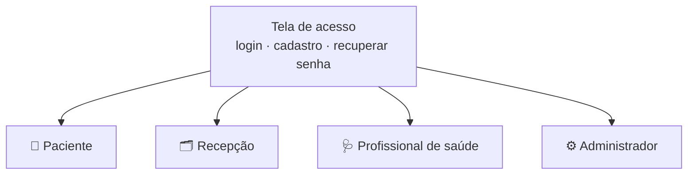
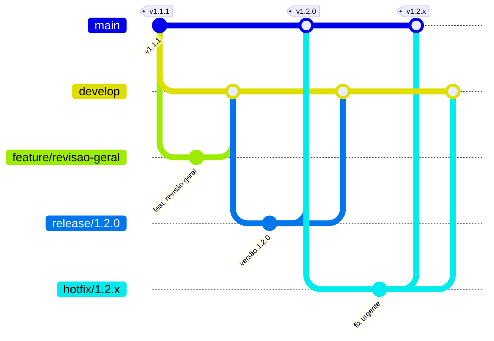

<div align="center">

# 🩺 Gestão de Consultas · Interface web

**Agendamento de consultas simples, acessível e pensado para todas as idades**

Projeto Integrador · SENAI


[Acessar o site](https://gestao-consultas.vercel.app) · [API](https://github.com/clinica-consulta/clinica-backend) · [Versões](https://github.com/clinica-consulta/clinica-frontend/releases)

</div>

---

## 📖 Sobre o projeto

A **Gestão de Consultas** é a plataforma web de uma clínica médica para marcar consultas, organizar a agenda dos médicos e acompanhar os pacientes do cadastro ao pós-atendimento. A proposta é que qualquer pessoa, inclusive idosos, consiga **agendar uma consulta em poucos passos**, vendo na hora os horários vagos, e que a equipe da clínica tenha tudo o que precisa em um só lugar para **reduzir faltas** e evitar horários duplicados.

Este repositório é a **interface web**. Os dados e as regras de negócio vêm da [API da Gestão de Consultas](https://github.com/clinica-consulta/clinica-backend).

## 🎯 Objetivos

- Agendamento rápido, com especialidade, médico, data e horário em um fluxo guiado.
- Telas com letras legíveis, botões grandes e boa leitura no celular e no computador.
- Uma área própria para cada perfil, com apenas as ações que fazem sentido para ele.
- Menos faltas, com confirmação de presença, lembretes e avisos.

## 👥 Áreas do sistema

O site tem uma tela de acesso única. Depois do login, cada pessoa cai na área do seu perfil.



### 🧑 Paciente
| Tela | O que oferece |
|---|---|
| **Início** | Próximas consultas com status e código, confirmação de presença, remarcação, cancelamento com confirmação e histórico das consultas passadas com "Ver todas" |
| **Agendar** | Fluxo guiado: especialidade, médico, data no calendário e horário livre, com aviso quando o convênio não cobre a especialidade |
| **Notificações** | Avisos da clínica, lembretes, atestados e receitas para abrir e imprimir, e pagamento simulado da consulta particular por Pix, cartão de crédito ou débito depois do atendimento |
| **Meu perfil** | Dados cadastrais, contato e convênio |

### 🗂️ Recepção
| Tela | O que oferece |
|---|---|
| **Dashboard** | Indicadores e atendimentos do dia; clicar em um horário vago abre o agendamento já preenchido |
| **Agenda** | Agenda de todos os médicos, com filtro por médico e especialidade e horários livres, ocupados e bloqueados |
| **Consultas** | Filtros por data, médico, especialidade e status; agendar, confirmar, remarcar, cancelar, enviar lembretes e registrar realizada ou não compareceu; histórico de alterações |
| **Pacientes** | Cadastro com CPF e telefone com máscara, edição, desativação e histórico de cada paciente |
| **Fila de espera** | Pacientes aguardando vaga, com prioridade, convite e agendamento direto da fila |
| **Médicos** | Corpo clínico com filtro por especialidade |
| **Horários e bloqueios** | Expedientes dos médicos e bloqueio de horários ou períodos |
| **Notificações** | Avisos da equipe e envio de avisos a pacientes e médicos |

### 🩺 Profissional de saúde
| Tela | O que oferece |
|---|---|
| **Início** | Consultas do dia e registro de atendimento realizado ou ausência |
| **Minha agenda** | Consultas por data |
| **Meus pacientes** | Pacientes atendidos, prontuário com o histórico de consultas e emissão de atestado, receita ou pedido de exame, com envio ao paciente e impressão |
| **Meus horários** | Expediente e bloqueios em modo somente leitura |
| **Notificações** | Avisos da clínica |

### ⚙️ Administrador
| Tela | O que oferece |
|---|---|
| **Visão geral** | Indicadores da clínica, relatório completo, planilhas de consultas e do registro de alterações prontas para abrir no Excel e botão de atualizar os dados |
| **Usuários** | Acessos da recepção e de outros administradores |
| **Médicos** | Cadastro, edição, ativação, desativação e exclusão de médicos sem consultas |
| **Especialidades** | Catálogo de especialidades da clínica |
| **Agendas e horários** | Expediente semanal de cada médico e bloqueios |
| **Configurações** | Dados da clínica, convênios com as especialidades cobertas e valor da consulta particular |

## ✨ Recursos em todas as áreas

- 🔎 **Busca no topo**: procura pacientes, médicos, usuários e especialidades e abre a tela certa já filtrada; para o paciente, leva direto ao agendamento da especialidade.
- 👤 **Minha conta**: ao clicar no próprio nome, cada pessoa edita nome e telefone e troca a senha.
- 🔐 **Recuperação de senha** com código de 6 dígitos enviado por e-mail e confirmação de CPF.
- 🔔 **Notificações** com contador de não lidas e opção de marcar todas como lidas.
- 📱 **Responsivo**: menu lateral no computador e barra inferior no celular.
- 📄 **Rodapé** com Privacidade, Termos de Uso e Suporte com o contato da clínica.
- ⏳ **Tela de carregamento** e mensagem de boas-vindas após o login.

## 📐 Como a interface aplica as regras da clínica

| Situação | O que a pessoa vê |
|---|---|
| Convênio não cobre a especialidade | O agendamento é bloqueado com a explicação do motivo |
| Horário já ocupado ou bloqueado | O horário não aparece como opção |
| Agendamento para hoje | Só aparecem horários a partir da hora atual |
| Consulta cancelada | O horário volta a ficar livre na agenda |
| Consulta remarcada | O paciente precisa confirmar a nova data |
| Paciente, médico ou especialidade desativados | Somem das opções de agendamento, mas o histórico continua visível |
| Médico com consultas | Não pode ser excluído, só desativado |

## 🏗️ Tecnologias

| Camada | Tecnologia |
|---|---|
| Interface | React e TypeScript |
| Framework | TanStack Start e TanStack Router (rotas por arquivo) |
| Estilo | Tailwind CSS e componentes Radix UI |
| Dados | API REST da Gestão de Consultas com sessão por token |
| Hospedagem | Vercel |

### Organização do código

```
src/
├── routes/        Uma rota por tela, separadas por perfil
├── components/    Páginas de cada perfil, formulários, modais e componentes de interface
├── lib/           Cliente da API, estado compartilhado, CPF, exportação de planilhas
├── hooks/         Hooks reutilizáveis
└── assets/        Logo e imagens
```

## 🚀 Versões

| Versão | Destaques |
|---|---|
| [1.2.1](https://github.com/clinica-consulta/clinica-frontend/releases/tag/v1.2.1) | Documentação do projeto e padronização do git flow |
| [1.2.0](https://github.com/clinica-consulta/clinica-frontend/releases/tag/v1.2.0) | Revisão geral: busca no topo, rodapé, agendamento preenchido, relatórios e documentos médicos |
| [1.1.1](https://github.com/clinica-consulta/clinica-frontend/releases/tag/v1.1.1) | Campo do código de redefinição aceita só 6 números |
| [1.1.0](https://github.com/clinica-consulta/clinica-frontend/releases/tag/v1.1.0) | Exclusão de médico pelo administrador |
| [1.0.1](https://github.com/clinica-consulta/clinica-frontend/releases/tag/v1.0.1) | Hotfix de segurança do TanStack Start |
| [1.0.0](https://github.com/clinica-consulta/clinica-frontend/releases/tag/v1.0.0) | Interface completa dos quatro perfis integrada à API |

## 🌿 Fluxo de trabalho (Git Flow)



| Branch | Para que serve | Nasce de | Volta para |
|---|---|---|---|
| `main` | Versão publicada, cada entrega com uma tag `vX.Y.Z` | | |
| `develop` | Integração do que está pronto | `main` | |
| `feature/nome` | Uma funcionalidade nova | `develop` | `develop` |
| `bugfix/nome` | Correção que pode esperar a próxima versão | `develop` | `develop` |
| `release/X.Y.Z` | Preparação da versão | `develop` | `main` e `develop` |
| `hotfix/X.Y.Z` | Correção urgente no site publicado | `main` | `main` e `develop` |
| `docs/nome` | Documentação | `develop` | `develop` |

- Versões seguem o [versionamento semântico](https://semver.org/lang/pt-BR/): `MAIOR.MENOR.CORREÇÃO`.
- Commits seguem o padrão `tipo: descrição` com os tipos `feat`, `fix`, `docs`, `test` e `chore`.
- Cada funcionalidade tem uma issue com labels de tipo, área, perfil e módulo, e fica no milestone da versão em que foi entregue.

---

<div align="center">

Guia técnico para rodar e publicar o site: [docs/desenvolvimento.md](docs/desenvolvimento.md)

</div>
